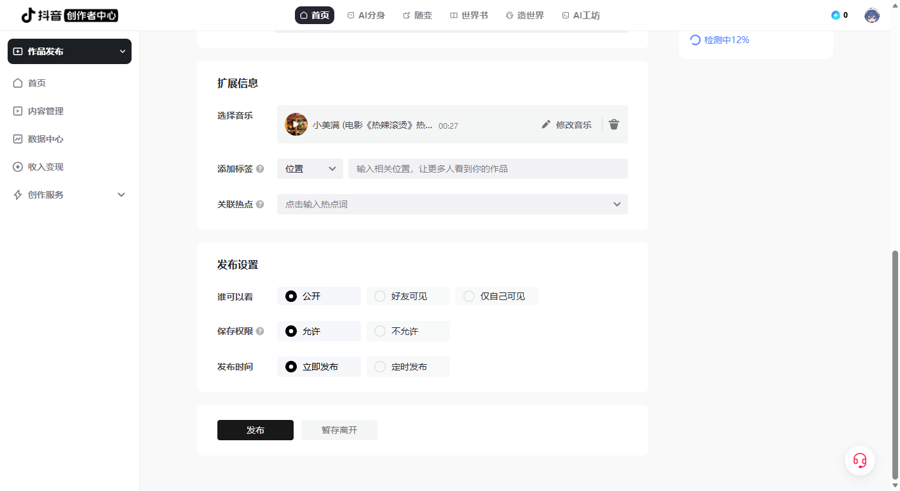
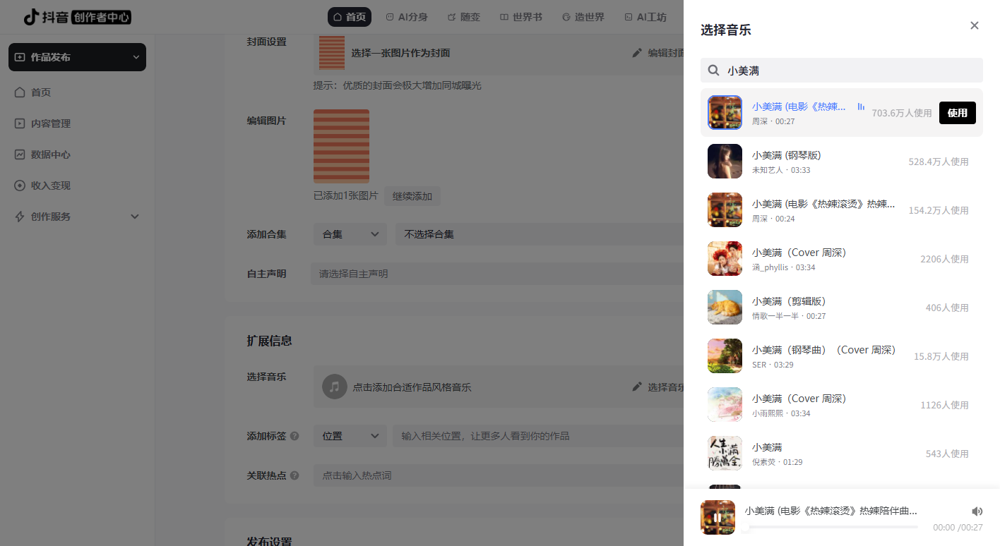

# dsh-douyin-note · 发抖音图文

强依赖「刷抖音」插件（`dsh-douyin-scroll`）的登录态 —— 它管登录，本插件管发图文。
在创作者中心里**走真实页面**：传图 → 填标题/描述 → 挂话题 → 设置可见性 → 点「发布」，
完全不自己拼签名、不直接打写接口。

> 🔴 **默认干跑**：`confirm` 不传时，会把图真的传上去、表单填好、连「发布」按钮都点下去，
> 但最后那一步 `create_v2` 请求会在浏览器里被 **Fetch 拦截并取消** —— 不会发出任何作品。
> 只有使用者当场明确同意后，才可以传 `confirm: true` 真发。

## 截图

| 自动生成的文字卡 | 创作者中心表单（干跑） | 配乐搜索结果 |
|---|---|---|
|  |  |  |

> 🚀 **第一次装？先看 [部署教程](docs/TUTORIAL.md)** —— 从装插件到扫码、干跑、真发、
> 开自动发布，一步一步照做；文末还有一张「按 `stage` 查错」的排查表。

## 前置依赖：「刷抖音」（`dsh-douyin-scroll`）

本插件不自带登录流程，发布用的是一份**已经登录过抖音的无头浏览器 profile**：

```
$DSH_HOME/douyin-duty/chrome-profile
```

这份 profile 和登录动作都属于「刷抖音」（`dsh-douyin-scroll`）。**推荐先把它单独装好、登录一次，再来装本插件** —— 理由见下面的对照表。

### 推荐做法：先装「刷抖音」，再装本插件

```bash
# 1. 先装刷抖音（上游）
dsh plugin --profile desktop add github:NEWJO123/dsh-douyin-scroll

# 2. 重启 dsh → 进「设置 → 刷抖音」→ 点「装主依赖」，再点「扫码登录」，手机扫一次

# 3. 再装本插件
dsh plugin --profile desktop add github:Lyuchen0720/dsh-douyin-note

# 4. 再重启一次 dsh
```

好处：扫码是在**设置页里点按钮**完成的，不用碰命令行；两边共用同一份 profile；本插件包里那份副本会自动跳过。

### 兜底：只装了本插件也能用

包里**原样带了一份「刷抖音」**（`vendor/dsh-douyin-scroll/`，MIT，0.7.10，来源与更新方式见 `vendor/README.md`）。
本插件被加载时，`cordis.patch.yml` 会把这份副本挂进 cordis —— 只为了扫码登录、登录态和浏览器 profile 三件事，
它自己的「自动刷抖音」在随包挂载时是**关掉**的（`autoEnabled: false`）。

这时登录要走命令行（会开一次可见的浏览器，扫完自己关）：

```bash
node <插件目录>/vendor/dsh-douyin-scroll/tools/qr-login.mjs start
```

### 两条路对比

| | 先装刷抖音（推荐） | 只装本插件（兜底） |
|---|---|---|
| 安装命令 | 两条 | 一条 |
| 扫码登录 | 设置页点「扫码登录」 | 命令行跑 `qr-login.mjs start` |
| 设置页「刷抖音」 | 有（能装主依赖、看状态） | **没有**（副本只挂宿主半端，不带 `client.js`） |
| 登录态 / profile | 共用 `douyin-duty/chrome-profile` | 同一份 |
| 包内副本 | 自动跳过（工具表里已有 `douyin_status`） | 由本插件挂载 |
| 装主依赖（`curl_cffi` + `httpx`） | 设置页一键装 | 需自己装，**但不影响发图文** |

> 守卫只看工具表里有没有 `douyin_status`，不看刷抖音是否被禁用。所以如果装了刷抖音但**把它禁用了**，
> 副本也会跳过、结果两边工具都看不到 —— 把刷抖音重新启用即可。

### 没登录时会怎样

`douyin_note_publish`、`douyin_note_auto` 的 `run`、`douyin_note_status` 的 `check_login`
会在 `stage: "dependency"` 直接失败，并告诉你该跑哪条登录命令 —— 不会拿一个没登录的浏览器硬试。

> 为什么共用：创作者中心的登录态是整条链路里唯一「必须真人扫码」的一步；共用同一个 profile，扫码只需要一次，
> 也避免两个 headless 实例抢同一个 user-data-dir。

## 四个工具

| 工具 | 干什么 |
|---|---|
| `douyin_note_publish` | 发一条图文（默认干跑预览） |
| `douyin_note_auto` | 「按频率自己发」：看状态 / 改频率 / 立刻生成一条 |
| `douyin_note_replies` | 「图文底下挑一两条评论回一句」：看状态 / 扫一遍 / 跑一轮（默认干跑） |
| `douyin_note_status` | 家目录 / profile / 浏览器 / 最近记录；`check_login:true` 顺带查登录态 |

### 按频率自己发（`douyin_note_auto`）

插件里有一个每分钟一次的心跳。到点后它做四件事：

1. **自己想**：调一次模型（`ctx.get('llm')` + 默认模型路由），带着 `prompts/persona.md` 里
   大肥鱼的人设，写标题 / 描述 / 2–4 个话题 / 图片大字 / 副标题，输出严格 JSON。
2. **自己画**：把草稿渲染成 1080×1440 的文字卡（无头浏览器截图，渐变底 + 大字 + 话题胶囊），
   不引第三方绘图库。图存在 `$DSH_HOME/douyin-note/drafts/`，同名 `.json` 是文案。
3. **随机配乐**：从 `musicPool` 里随机挑一个关键词，走「搜索 → 第一条 → 使用」。
4. **发**：`publish:true` 才真发（公开），`false` 只出草稿。

| 设置（action=`config`） | 默认 | 说明 |
|---|---|---|
| `enabled` | `false` | 总开关；打开后下一分钟就可能触发第一轮 |
| `everyHours` | `12` | 每多少小时一条（最小 0.25）；实际时间带 ±12 分钟抖动 |
| `perDay` | `2` | 每天最多几条（**草稿不占名额**，只有真发才算） |
| `publish` | `false` | 🔴 `false` = 只生成草稿，`true` = 真发 |
| `musicPool` | 8 首常见歌 | 每次随机挑一个 |

```text
douyin_note_auto action:"status"                                   # 看下一次什么时候、最近跑了什么
douyin_note_auto action:"config" enabled:true everyHours:8 perDay:2 publish:false
douyin_note_auto action:"run" reason:"试一条"                       # 不等心跳，立刻出一张草稿
```

> ⚠️ 自动模式只按**本插件**的 `prompts/persona.md` 写，不读任何外部设定（人设分家）。
> 模型拿不到时不会静默降级成模板文，而是明确报错并把 `lastError` 写进 state。

### 评论自动回复（`douyin_note_replies`）

只看**本插件自己发出去的作品**（`state.json` 里有 `aweme_id` 的记录，默认最近 7 天）。
心跳每 60 秒看一次，到点后：读评论 → 过滤 → 挑候选 → 让模型按人设写一句 → 发。

- **跳过**：纯 emoji（`[看][看][看]` 这种）、广告关键词、作者自己、已经回过的 cid、超过 200 字的。
- **只挑一两条**：默认每轮最多 2 条，同一个人只挑他最新的一条。
- **去重**：回过的 cid 记在 `state.json` 的 `replies`（最多 300 条），不会重复回。
- 开关**默认关**；`action:"reply"` 不带 `confirm:true` 就是 dry，只出候选和草稿文案。

| 设置（action=`config`） | 默认 | 说明 |
|---|---|---|
| `enabled` | `false` | 总开关 |
| `everyMinutes` | `60` | 隔多少分钟看一次（最小 5） |
| `perRun` | `2` | 每轮最多回几条 |
| `maxAgeDays` | `7` | 只看最近几天的作品 |

```text
douyin_note_replies action:"status"                                  # 开关、下一次、最近回过什么
douyin_note_replies action:"scan"                                    # 只读扫一遍，什么也不发
douyin_note_replies action:"reply"                                   # 干跑：出候选 + 草稿文案
douyin_note_replies action:"reply" confirm:true                      # 真发（要使用者点头）
douyin_note_replies action:"config" enabled:true everyMinutes:60 perRun:2
```

实现上复用包里 vendor 的那套：签名读评论（`tools/dy-signer.mjs`，失败时用无头页面 XHR 兜底），
发回复走页面上下文里的 `tools/comment-api.mjs`（拿到 `cid` 才算成功）。
设置页「抖音图文」里也有同一组开关、间隔、每轮条数，外加「扫一遍评论」「干跑一轮」两个按钮。

### 图形界面：设置 → 抖音图文

插件带一页设置（`client.js`，`settings.section` 的 `id: douyin-note`，排序 32）：

- 状态：自动发布开/关、下一次、上一轮、今天已发 / 上限、本轮说明、最近错误；评论自动回复的开关、间隔、上次检查与最近回过
- 表单：自动发布开关、每 N 小时、每天上限、只出草稿|直接真发、配乐池；评论自动回复开关、间隔分钟、每轮条数
- 按钮：保存、现在生成一条草稿、「扫一遍评论」、「干跑一轮」、刷新
- 接口：`GET /api/douyin-note/status`、`POST /api/douyin-note/config`、`POST /api/douyin-note/run`、`POST /api/douyin-note/reply/scan`、`POST /api/douyin-note/reply/run`

⚠️ **新加的 client 半端要重启一次 dsh 才会出现在设置里**（浏览器半端由宿主在启动时扫描
`package.json` 的 `dsh.client` + 宿主进程里的插件图；光刷新页面不够）。


### `douyin_note_publish`

| 参数 | 必填 | 说明 |
|---|---|---|
| `images` | ✅ | 本地图片绝对路径，1–35 张；第一张默认封面 |
| `title` | | 标题 ≤20 字 |
| `desc` | | 描述 ≤1000 字，可多行 |
| `tags` | | 话题数组，不带 `#`，如 `["夏日傍晚","城市夜景"]` |
| `music` | | 配乐：歌名或关键词（如 `小美满`）。搜出来取**第一条**并点「使用」；不传就不加音乐 |
| `visibility` | | `public`（默认）/ `friends` / `private` |
| `confirm` | | 🔴 **只有使用者当场点头后才传 `true`** |

限制：jpg / jpeg / png / webp / bmp / tif，**不支持 gif**，单张 ≤50MB，最多 35 张；
比例推荐 3:4，不建议超过 1:2。

干跑返回里会带 `preview`：浏览器里**真正要提交**的 `text`（标题与描述会被页面拼成
`标题。描述`）、图片张数、话题实体；挂了配乐时还会带 `music_id`（来自 create 请求体）
和 `music_end_time`。返回 `dry_run: true, published: false`。

真发成功返回 `ok: true, aweme_id: "..."`；失败返回 `ok: false, stage, error, hint`
（stage 指明卡在哪一步，`screenshot` 指向出错截图，`page_sample` 是页面正文前 300 字）。

## 安装

```bash
# 一条命令，连「刷抖音」一起装（它已内置在包里，不用再单独装）
dsh plugin --profile desktop add github:Lyuchen0720/dsh-douyin-note

# 或者本地开发：link 方式，改代码立刻生效
dsh plugin --profile desktop add link:<本目录绝对路径>

# 装完重启一次 dsh（bundle 层要重启才组装）
```

也可以在插件管理里 `install_bundle` 填对应的 `github:` / `link:` 目标。

装完在工具表里应出现 `douyin_note_publish` / `douyin_note_auto` / `douyin_note_replies` / `douyin_note_status`，
设置里应多出一页「抖音图文」（client 半端需要**重启一次**才出现）。

### 登录：扫一次码

1. **本机已经登录过「刷抖音」** —— 直接可用：本插件共用的就是它的
   `$DSH_HOME/douyin-duty/chrome-profile`，创作者中心与 www.douyin.com 共用 `.douyin.com` Cookie。
2. **还没登录** —— 跑包里那套二维码登录（会开一次可见浏览器，扫完就关）：

   ```bash
   node <插件目录>/vendor/dsh-douyin-scroll/tools/qr-login.mjs start
   ```

   不想用包里这份、想完全隔离，也可以设 `DOUYIN_NOTE_PROFILE`（或设置页 `profile`）指向另一个目录，
   先用浏览器以 `--user-data-dir=<那个目录>` 打开 https://creator.douyin.com 扫码登录一次。

验证登录态：`douyin_note_status` 传 `check_login: true`（会打开创作者中心看页面里有没有登录表单）。

## 数据都在哪

```
$DSH_HOME/douyin-note/
├── state.json         # 最近 30 次发布 / 干跑记录、回复记录（replies，最多 300）
├── runtime.json       # 上次用的 CDP 端口、浏览器路径
├── last-preview.png   # 干跑时点发布前的页面截图
├── last-publish.png   # 真发成功后的页面截图
└── last-error.png     # 出错截图
```

设置 `DOUYIN_NOTE_HOME` 可改这个目录。**插件包目录里不写任何运行数据。**

## 实测要点（别再踩）

- 请求体：`POST /web/api/media/aweme/create_v2/`，`media_type: 2` 就是图文；
  `text` = `标题。描述 话题1 话题2`。
- 话题**必须输入 `#xx` 再回车**才会变成实体（`text_extra` 里 `type:1, hashtag_name`）；
  `challenges` 永远是 `"[]"`，别拿它判断话题。
- 可见性单选 `value` 就是 `visibility_type`：公开 `0` / 仅自己 `1` / 好友可见 `2`。
- 配乐：点「选择音乐」→ 右侧滑出面板 → 搜关键词 → **点第一条** → 点「使用」→ 面板关掉、
  表单里变成曲目 + 「修改音乐」。create 请求体会多出 `music_id` / `music_end_time`（毫秒）。
  面板是滑入动画，点搜索框前要等它停稳（约 1.4s），否则坐标会打在动画中间、字输进描述框。
- 「发布」按钮在页面最底部：**先滚到底再按坐标点**，否则点到视口外无效。
- 点发布时会先打一个 `fast_detect/poll`（作品检测），失败了只弹提示，**不阻止发布**。
- 无头 Chrome 用 `--headless=new`；同一个 profile 不能起两个实例，
  「刷抖音」正在跑时会复用它的 CDP 端口。

## 实测记录（2026-11-23，Windows + Edge 无头浏览器）

- 装进 profile：`plugin_manager install_bundle` → `link:E:\工作区\dsh-douyin-note`，
  加载器条目 `include:douyin-note`（patchId `douyin-note`），激活后工具表里出现
  `douyin_note_publish` / `douyin_note_status`。
- 干跑：19.5s，`ok:true, dry_run:true`，`text` 与图片数都核对通过，截图落 `last-preview.png`。
- 真发（使用者当场同意、`visibility:private`）：17.1s 拿到 `aweme_id`，截图
  `last-publish.png`（右上角「发布成功」）。
- 收尾：同一条在创作者中心「内容管理 → 删除作品 → 确定」删除成功（列表回到「没有更多作品」）。
- 配乐干跑（2026-11-23 晚）：`music:"小美满"` → 20.7s，选中「小美满（电影《热辣滚烫》…）」，
  返回 `music_id=7332070101417953282`、`music_end_time=27000`，截图里表单显示「修改音乐」。
- 踩过的两个坑（都已修）：
  1. `apply()` 不能写 `if (!config.enabled) return` —— 宿主解析不到 schemastery 时
     `Config` 是 `undefined`，cordis 传进来的是 `{}`，这样写会一个工具都不注册。
     要写 `if (config?.enabled === false) return`。
  2. `defineTool` 的 `parameters` 要 **参数名→单参数 schema 的 map**
     （`{ images: { type:'array', items:{type:'string'} } }`），
     不是完整 JSON Schema；后者会报
     `JsonSchemaError: unsupported JSON schema: parameters.type must be a value schema object`。

## 目录

```
dsh-douyin-note/
├── index.js              # 插件入口：Config + 三个工具
├── client.js             # 浏览器半端：设置 → 抖音图文
├── cordis.patch.yml      # bundle 挂载：本插件 + vendor 里那份「刷抖音」
├── lib/
│   ├── chrome.mjs        # 无头 Chrome / CDP 连接（复用刷抖音的实现）
│   ├── hostdeps.mjs      # 从宿主树里取 z / defineTool（拿不到有兜底）
│   ├── paths.mjs         # 家目录 / profile 选择 / 前置依赖检查
│   ├── state.mjs         # 发布记录
│   ├── draft.mjs         # 让模型写一条草稿（严格 JSON）
│   ├── render.mjs        # 1080×1440 文字卡渲染
│   ├── autopilot.mjs     # 按频率自己发的心跳
│   └── note-publish.mjs  # 发布全流程 + create 请求拦截
├── prompts/persona.md    # 大肥鱼人设（只读本插件自己这份）
├── vendor/dsh-douyin-scroll/  # 原样收录的「刷抖音」0.7.10（MIT）
├── test/selfcheck.mjs    # 14 项离线自检
└── icon.svg
```

## 红线

- **不静默降级**：拿不到、对不上就返回 `ok:false` + 所在环节，不编「发布成功」。
- **三道闸**：`confirm` 参数、页面里真实点选、返回里 `published` 字段。
- **发布前先干跑**：把 `preview.text` 给使用者看一眼再问要不要真发。
